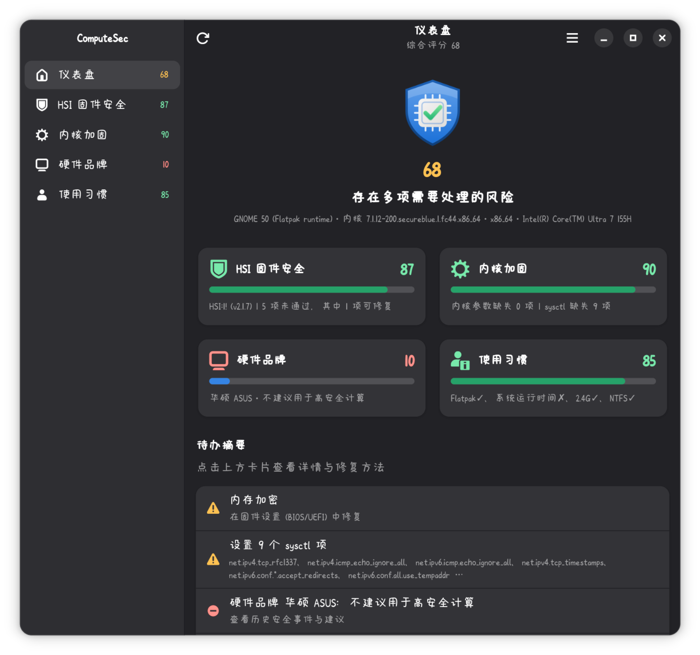

<div align="center">

# ComputeSec

<p align="center">
  
</p>

**A Linux desktop security assessment tool built with GTK4 / libadwaita / Python. It reads the state of your system, compares it against a security baseline, explains in plain language what every check means and what you risk by leaving it off, and hands you copy-and-paste fixes. Whatever you already got right is shown in green: keep it up! 🤗**

[](./LICENSE)

<p align="center">
  [🇺🇸 English] • <a href="README.md">🇨🇳 中文</a> •
  <a href="https://s.92li.uk/">🌐 Official Website</a> •
  <a href="https://github.com/lingyicute/ComputeSec/releases">📦 Download</a> •
  <a href="https://github.com/lingyicute/ComputeSec/issues">🐛 Report Bug</a>
</p>



</div>

## Why build this?

To take the distance out of security hardening.

For users without a technical background, "security hardening" often feels impossibly far away: most professional security advice reads as something you could never actually do. So I built this little tool.

Here, security advice is plain-spoken and actionable. ComputeSec will not tell you "your CPU has a silicon erratum" — that is just useless scaremongering. It will tell you "your IOMMU is disabled in the BIOS; reboot and turn it on" — that is what security engineering actually looks like.

## Pages

### 1. Dashboard
* **At a glance**: overall score, cards for the four assessment areas, and a summary of outstanding to-dos.

### 2. HSI Firmware Security
* **Status**: reads Host Security ID (HSI) results through the fwupd D-Bus interface (or `fwupdmgr security`).
* **Risk explanation**: describes what each attribute means and what an attacker can do when it is missing or disabled.
* **Remediation ("You can fix this" section)**:
  * Steps are grouped into **"in the operating system"** and **"in firmware setup"**.
  * Covers IOMMU, Kernel Lockdown, encrypted swap, Secure Boot, TPM, s2idle, and more.

### 3. Kernel Hardening
* **Reading and comparing state**:
  * Reads `/proc/cmdline` and `/proc/sys` (the equivalent of `sysctl -a`).
  * Root-only entries (such as `vm.mmap_rnd_bits`) are filled in from the `sudo sysctl -a` output you paste via the data collection wizard; without it they are reported as "cannot read" and are **excluded from scoring**.
  * Compares them against the built-in recommended kargs list and sysctl hardening list for your architecture (amd64 / aarch64).
* **Version line check**: at startup the app asks kernel.org for the current mainline / stable version. If your kernel belongs to neither (for example any LTS branch), it states plainly that LTS branches do **not** carry all upstream security fixes and hardening improvements, so the recommended sysctls and boot parameters are **not guaranteed** to deliver the intended hardening on those kernels (some parameters do not exist on older kernels, others are silently ignored by the kernel even when present on the command line, and some are then wrongly counted as hardened because they appear in `/proc/cmdline`). Conclusions drawn on such a branch **must not be used as a basis for hardening**; switching to a mainline or stable kernel is recommended. If the check fails (offline, blocked by a firewall, or the Flatpak network permission revoked) you are not bothered — the Kernel page shows a **not verified** row with a retry button, and the main menu can re-run it too. If the fetch fails while an expired cache exists, the app still reports a conclusion but states how old those version numbers are.
* **Three cases that are excluded from scoring** (they never lower the score, and they do not mean "passed"):
  * **cannot read**: the file is not readable by your user (e.g. `vm.mmap_rnd_bits` is `0600 root:root`);
  * **unverified**: readings taken inside the Flatpak sandbox cannot be trusted (without host network sharing, `net.*` belongs to a private network namespace; or the snapshot you provided does not cover the entry), so they are ignored;
  * **suspected**: an unconfirmed 2.4G wireless receiver is only a reminder (see "Usage Habits").
* **Quick fixes and guidance**:
  * One-click copy of the missing parameters.
  * Instructions for `grubby` / GRUB / systemd-boot / rpm-ostree.
  * Generates `/etc/sysctl.d` drop-in files together with setup instructions.
* **Architecture note**: on aarch64 it prompts you to probe the maximum usable value of `vm.mmap_rnd_bits` by hand.

### 4. Hardware Vendor
* **Vendor identification**: reads DMI / device tree to identify the hardware manufacturer.
* **Reputation database**: cross-checks a built-in vendor security reputation database, which documents incidents such as Lenovo Superfish/LSE, ASUS ShadowHammer, the MSI Boot Guard private key leak, Gigabyte's backdoor-style UEFI updater, and Dell's eDellRoot.
* **Advice**: for vendors with a tarnished record, it recommends against using them in high-security computing environments.

### 5. Usage Habits
* **Flatpak ecosystem assessment**:
  * Counts installed apps (runtimes and desktop-environment bundled packages are excluded automatically).
  * Suggests using Flatpak more if you have fewer than 5 apps.
  * Recommends my [harden-flatpak](https://github.com/lingyicute/harden-flatpak) project, which denies all Flatpak permissions by default, paired with Flatseal for per-app permission hardening.
* **Uptime reminder**: when the system `uptime` exceeds one day, it reminds you to update and reboot.
* **Peripheral security check**: detects 2.4 GHz wireless receivers and warns about potential keystroke sniffing. Confirmed receivers deduct points; devices whose vendor/model strongly suggests a 2.4 GHz dongle but which cannot be confirmed as a keyboard/mouse receiver (for example the product string only says Receiver / Dongle) are reported as **"suspected"** — a reminder only, **no points deducted**, together with steps to verify it yourself. Bluetooth adapters, IR receivers, TV tuners and other radios are not considered.
* **Environment isolation check**: detects NTFS / BitLocker partitions or a Windows installation (unauditable, and liable to contaminate your Linux environment).
* **Unreadable means unscored**: if a check on this page cannot read what it needs (no flatpak installed, no `/run/udev` access), it shows as **unreadable** and is **not counted towards the score** instead of being scored as a middle value — you cannot improve it, so deducting points would only distort the score.

## Option 1: Flatpak (recommended ⭐)

> [!TIP]
> **Why Flatpak is the recommended way to run ComputeSec？**
> 
> ComputeSec is software too, and it may contain vulnerabilities. State-sponsored targeted
> attackers may attack this software in order to execute code on your computer. Running
> ComputeSec inside the Flatpak sandbox isolates it from the rest of your system and serves
> as defense in depth — even if the application itself is compromised, the sandbox limits
> the damage an attacker can do. 

### Install from a release

Download the `.flatpak` for your architecture from [Releases](https://github.com/lingyicute/ComputeSec/releases):

```bash
flatpak install --user ./ComputeSec-x86_64.flatpak
flatpak run uk._92li.lingyicute.ComputeSec
```

### Build locally

```bash
flatpak install flathub org.gnome.Platform//50 org.gnome.Sdk//50
flatpak-builder --user --install --force-clean build-dir uk._92li.lingyicute.ComputeSec.json
flatpak run uk._92li.lingyicute.ComputeSec
```

### Flatpak permissions

The tool has to read information from the host, so it requests the permissions below. You can revoke any of them at any time with Flatseal — the corresponding feature will then simply report "unavailable".

| Permission | Purpose |
| --- | --- |
| `--system-talk-name=org.freedesktop.fwupd` | Read HSI results over D-Bus |
| `--system-talk-name=org.freedesktop.hostname1` | Read the **host's** distro name, kernel version and machine model over D-Bus (inside the sandbox `/etc/os-release` describes the runtime, not your system) |
| `--share=network` | Read the current mainline / stable version from kernel.org to tell whether the running kernel is supported; it also makes the sandbox's `/proc/sys/net` the host's network view |
| `--filesystem=/var/lib/flatpak:ro`, `~/.local/share/flatpak:ro` | Count installed Flatpak apps |
| `--filesystem=/run/udev:ro`, `/boot:ro`, `/efi:ro` | Detect NTFS / BitLocker partitions and the Windows boot loader (`/boot:ro` covers both `/boot/efi` and `/boot/EFI` ESP layouts) |

`/proc/cmdline`, `/proc/sys`, `/sys/class/dmi` and `/sys/bus/usb` are readable inside the sandbox by default and need no extra permissions.

> **About the network permission**: `--share=network` is used only to fetch `releases.json` (version
> numbers) from kernel.org at startup. Nothing about your system is uploaded, and the result is
> cached for 24 hours. You can revoke it with Flatseal: the version line check then shows
> **not verified**, and because `net.*` inside the sandbox belongs to a private network namespace
> those readings are no longer trusted — they show up as "unverified" and are excluded from scoring.
> Everything else keeps working.

> **This tool does not request `--talk-name=org.freedesktop.Flatpak`from version 1.0.3.**
> That permission allows running arbitrary commands on the host as you via `flatpak-spawn --host`,
> which is equivalent to a sandbox escape and far too invasive for a read-only auditing tool.
> Anything that needs higher privileges is instead gathered through the data collection wizard.

### Data collection wizard

Some values simply cannot be read as a normal user: the `/proc/sys` files behind
`vm.mmap_rnd_bits` and `vm.mmap_rnd_compat_bits` are `0600 root:root`, and more entries
are hidden inside the Flatpak sandbox.

So ComputeSec shows a step-by-step wizard at startup:

1. Each step shows one **read-only command** (e.g. `sudo sysctl -a`) that you can copy with one click.
2. You run it in your own terminal and check the output.
3. Copy the output, come back and press "**I've copied the result**" — the app reads the
   clipboard directly and parses it. No ugly paste box.

Results are stored only in `~/.local/share/computesec/hostdata.json` together with the current
`boot_id`, so they **expire automatically on reboot** (sysctl values may have changed) and you are
not asked again during the same boot. Every step can be skipped; skipped checks are shown as
"cannot read" and are **excluded from scoring** (inside the Flatpak sandbox there is also an
"unverified" state: the reading comes from the sandbox rather than the host, and is likewise
excluded). You can re-run the wizard any time from the main
menu ("Re-collect system data", Ctrl+D).

## Option 2: Clone and run directly

Best suited for developers who want to follow the latest code. Note that this way the program
runs directly with your user permissions, **without any sandbox isolation**; for everyday use,
please prefer Option 1.

Requirements: Python ≥ 3.12, PyGObject, GTK 4, libadwaita ≥ 1.4 (Fedora 39+ / Ubuntu 24.04+ / Debian 13+ / Arch), and `fwupd` for HSI.

```bash
# Fedora
sudo dnf install python3-gobject gtk4 libadwaita fwupd
# Debian / Ubuntu
sudo apt install python3-gi gir1.2-gtk-4.0 gir1.2-adw-1 fwupd
# Arch
sudo pacman -S python-gobject gtk4 libadwaita fwupd
```

```bash
git clone https://github.com/lingyicute/ComputeSec.git
cd ComputeSec
python3 run.py
```

To make it show up in your app menu and display the correct icon in the taskbar/dock (on Wayland the `.desktop` file must match the App ID):

```bash
python3 run.py --install     # install the .desktop file and SVG icons into ~/.local/share
python3 run.py --uninstall   # remove them
python3 run.py --version     # print the version (no display needed)
python3 run.py --help        # all options
```

It can also be installed as an ordinary Python package, which additionally installs the
`computesec` command, the `.desktop` file, the metainfo file and the icon. PyGObject, GTK 4
and libadwaita must come from your distribution (they cannot be installed with pip), so install
them with the commands above first. Most distributions refuse `pip install` into the system
Python (PEP 668); use a virtual environment created with `--system-site-packages`, otherwise it
cannot see the distribution's PyGObject:

```bash
python3 -m venv --system-site-packages ~/.venvs/computesec
~/.venvs/computesec/bin/pip install .
~/.venvs/computesec/bin/computesec --install   # optional: menu entry and icon in ~/.local/share
pip install -e ".[dev]"                        # dev environment: adds pytest / ruff / fonttools / brotli
```

The `computesec` command accepts exactly the same options as `python3 run.py`. The `.desktop`
file and icon installed by pip live under the virtual environment's `share/`, where desktop
environments do not look; run `computesec --install` as above if you want a menu entry.

## Project layout

```
run.py                  Launcher (for a cloned checkout; /app/bin/computesec inside Flatpak)
computesec/
  ├── cli.py            Command-line options and desktop integration (shared by run.py and the pip-installed command; no gi)
  ├── main.py           Application and window, navigation, background scanning threads
  ├── ui.py             Construction of the five pages
  ├── checks.py         Data collection and comparison (fwupd, cmdline, sysctl, DMI, Flatpak, uptime, USB, NTFS)
  ├── wizard.py         Data collection wizard (run read-only commands step by step + read clipboard)
  ├── hostdata.py       User-assisted host data: parsing, validation, caching (expires by boot_id)
  ├── kernelver.py      Kernel version line check (kernel.org mainline / stable, cached for 24h)
  ├── hostinfo.py       Host identity (D-Bus org.freedesktop.hostname1)
  ├── xdg.py            XDG data directory (shared by cli / hostdata / kernelver)
  └── data.py           Knowledge base: HSI descriptions, kernel parameters, sysctl, vendor reputation
tests/                  Unit tests (pytest, no GTK/D-Bus needed, run: python -m pytest)
                        test_ui_smoke.py additionally needs PyGObject and a display; it is skipped otherwise
pyproject.toml          Packaging metadata, pytest / ruff project config
data/
  └── Icons and build metadata
uk._92li.lingyicute.ComputeSec.json      Flatpak manifest
.github/workflows/build.yml              Build workflow
```

## Notes

- Machine-specific boot options in the kernel parameter list — `root=`, `rootflags=`, `rw`, `rhgb`, `quiet`, `vconsole.keymap` and friends — are never evaluated. Never copy someone else's `root=UUID=...`.
- Some hardening parameters have minor side effects (for example `module.sig_enforce=1` blocks the proprietary NVIDIA driver from loading, `ia32_emulation=0` breaks Steam/Wine, and `mitigations=auto,nosmt` disables hyper-threading). Each of those is flagged with a ⚠ in the UI. It is a good idea to test them once by pressing `e` in the GRUB menu and adding them temporarily.

> [!IMPORTANT]
> For security reasons, I recommends against using the closed-source NVIDIA driver and closed-source kernel modules, and against running Windows programs of unknown origin under Wine.

- Vendor reputation information is drawn from public reporting and CVE records, and is provided for reference only.

## 🗂️ License

This program is released under the GNU General Public License v3.0 (GPLv3).

Copyright © 2025-2026 lingyicute.

This program is free software: you can redistribute it and/or modify
it under the terms of the GNU General Public License as published by
the Free Software Foundation, either version 3 of the License, or
(at your option) any later version.

This program is distributed in the hope that it will be useful,
but WITHOUT ANY WARRANTY; without even the implied warranty of
MERCHANTABILITY or FITNESS FOR A PARTICULAR PURPOSE.  See the
GNU General Public License for more details.

You should have received a copy of the GNU General Public License
along with this program.  If not, see https://www.gnu.org/licenses.
